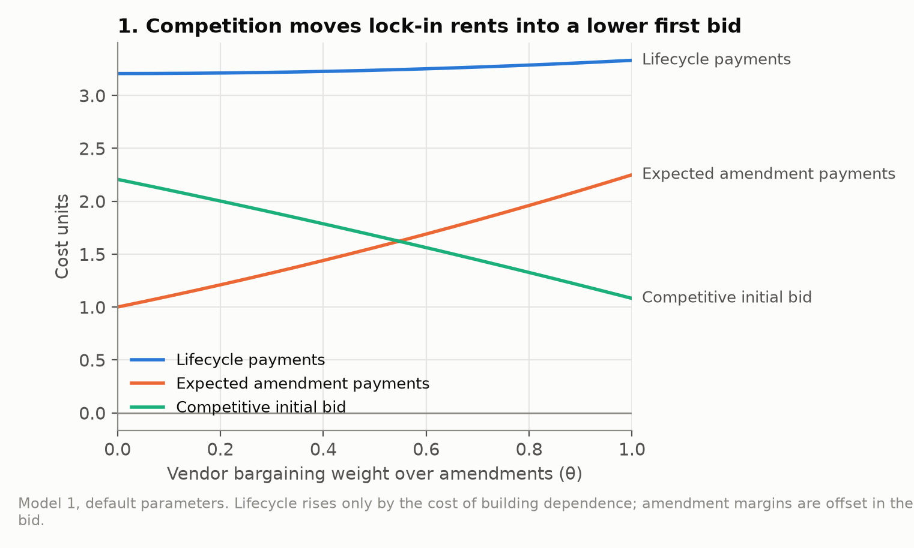
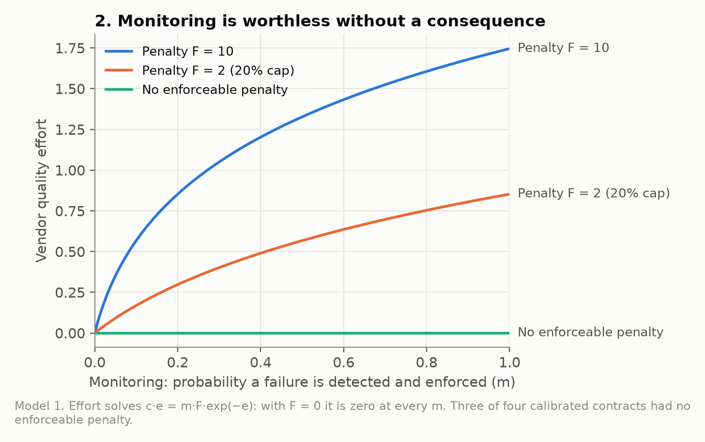
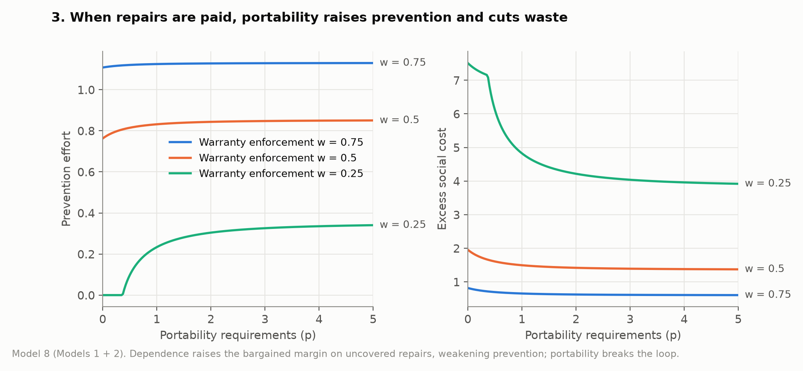
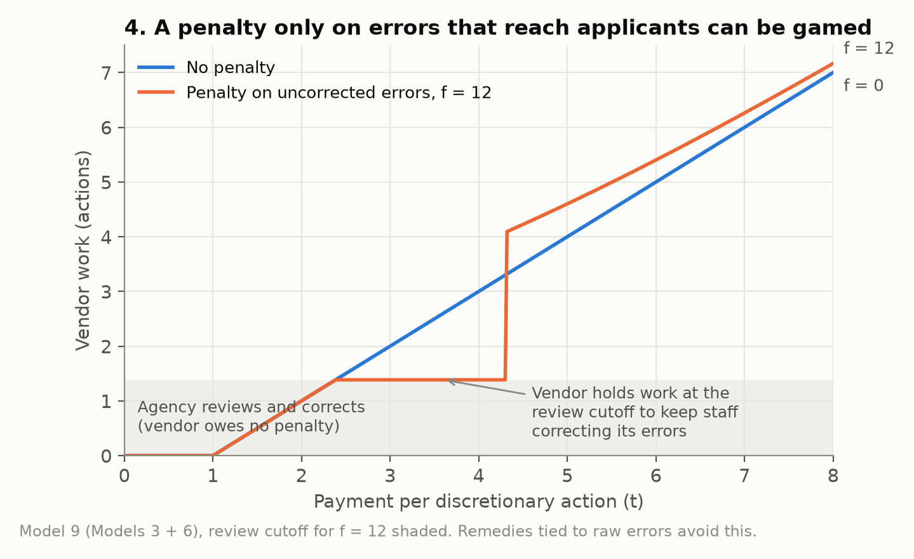
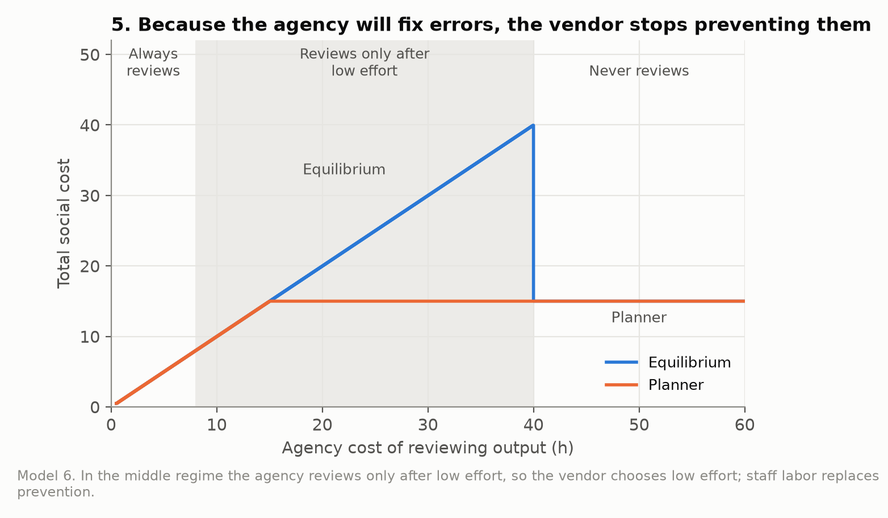
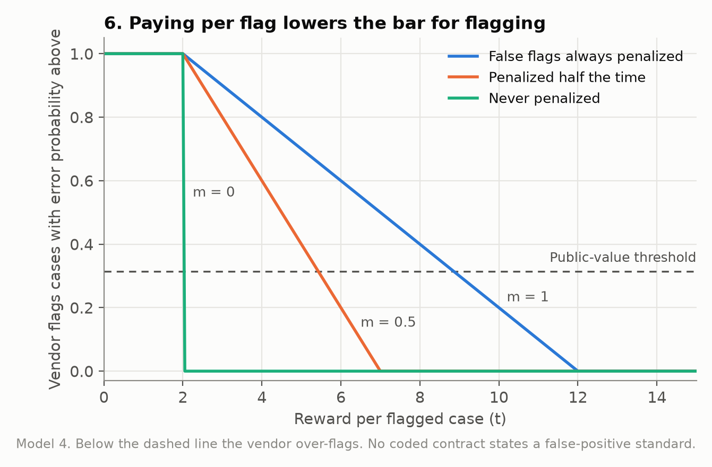
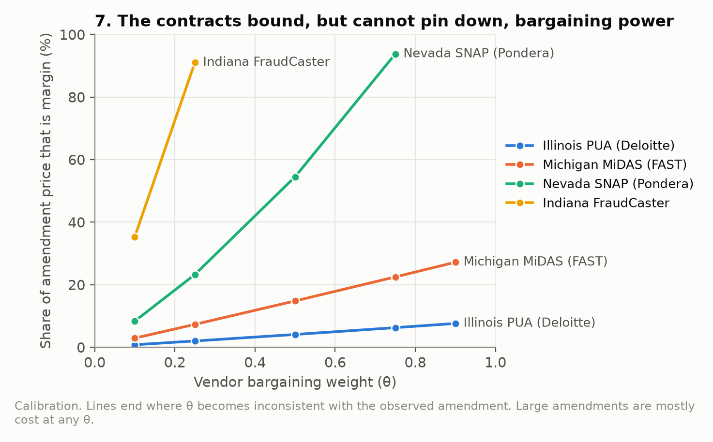

# contract_simulation

Game-theoretic models of how procurement terms shape vendor behavior, public spending, and applicant burden. This is a companion to *Profits and Burdens: Artificial Intelligence and the American Contracting State*.

The project asks one question: **when does buying compliance technology become persistent vendor dependence, and weak incentives to reduce burden?** It answers in four layers:

1. a conceptual memo,
2. formal models,
3. simulations and contract-design optimization,
4. a calibration to real state contracts.

Everything here is theory and illustration. No result establishes misconduct, intent, actual vendor profits, or causal effects.

## Repository layout

| Path | Contents |
| --- | --- |
| [recommendations.md](recommendations.md) | Contract-design recommendations and checklist for agencies, drawn from the results below |
| [manuscript/vendor_exploitation.md](manuscript/vendor_exploitation.md) | Twelve procurement vulnerabilities, their generative/agentic AI variants, and priority hypotheses |
| [game_theory/README.md](game_theory/README.md) | Model 1: competition, dependence, and amendment bargaining |
| [game_theory/extensions.md](game_theory/extensions.md) | Models 2–9, optimal contract design, and calibration method |
| [simulation/](simulation/README.md) | Python solvers, parameter sweeps, design optimizer, calibration, and tests |
| [simulation/calibration/](simulation/calibration/) | Hand-verified contract records, clause codes, and coding rules |
| [docs/figures/](docs/figures/) | Explanatory figures for this README, generated by `simulation/make_figures.py` |
| [simulation/outputs/](simulation/outputs/) | Timestamped simulation and calibration runs; earlier runs are preserved |
| [dashboard/](dashboard/README.md) | Static browser lab for all nine models; it re-solves equilibria live |
| `data/` | 81 contract PDFs and price catalogs: EPIC FOIA productions and NASPO ValuePoint agreements |

## Workflow

### Step 1. Mechanisms (manuscript)

The memo separates *demand* for compliance technology from the *contractual conditions* that let vendors earn rents. It identifies twelve vulnerabilities:

- lowball bids followed by costly amendments;
- cooperative purchasing without local validation;
- lock-in;
- restrictive licenses;
- payment for verification volume;
- rewarding flags over accuracy;
- continuity-driven extensions;
- policy changes as incumbent revenue;
- reseller layers;
- vendor-shaped specifications;
- weak inspection rights;
- product changes after evaluation.

It also compares how each changes with generative and agentic AI.

### Step 2. Formal models (game_theory)

Each model changes one assumption of the baseline, so that its mechanism can be told apart from switching-cost bargaining.

| Model | Mechanism | Central result |
| --- | --- | --- |
| 1 | Competition, dependence, Nash-bargained amendments | Competitive bids absorb expected amendment margins; dependence and low quality still waste resources |
| 2 | Paid remediation | Paid repair margins weaken prevention unless enforced warranty coverage exceeds μ/(μ+r+f) |
| 3 | Metered workflows | Per-action pay can cause too much work; a fixed fee can cause too little |
| 4 | Rewarded flags | The vendor's flagging threshold diverges from the public-value threshold |
| 5 | Shared and local validation | Shared testing is underprovided by free riding; local testing is omitted when agencies discount local benefits |
| 6 | Human review | The agency cannot commit not to review, which induces low vendor effort and hidden staff labor |
| 7 | Post-award substitution | Limited detection makes cheaper, harmful substitution privately attractive |
| 8 | Models 1 + 2 combined | Dependence prices uncovered repairs; portability now raises prevention |
| 9 | Models 3 + 6 combined | Vendors can hold work at the agency's review threshold so that staff correct their errors |

### Step 3. Simulation, design, and calibration (simulation)

```sh
cd simulation
uv sync --locked --cache-dir .cache/uv
.venv/bin/python -m unittest -v                                # 17 tests
.venv/bin/python run.py                                        # sweeps for Models 1-9 plus design problems
.venv/bin/python build_visualization.py outputs/<run_dir>      # optional explorer for saved results
.venv/bin/python calibration/extract_terms.py                  # only if PDFs or rules change; needs pdftotext
.venv/bin/python calibrate.py                                  # calibration report
.venv/bin/python make_figures.py                               # README figures -> docs/figures/
```

- **Equilibrium solvers** ([models.py](simulation/models.py)). Continuous problems use analytic boundary checks and bisection on first-order conditions. Model 8's joint choice uses an exact best response for dependence, then a global grid search over effort refined by bisection on the slope of the resulting payoff. Discrete games use backward induction or closed-form mixed equilibria.
- **Sweeps** ([config.json](simulation/config.json)). 241 parameter combinations across nine models. Each run writes CSVs, figures, `REPORT.md`, `design.json`, and a manifest with source hashes.
- **Optimal contract design** ([design.py](simulation/design.py)). The agency commits to instruments within bounds, such as monitoring, portability, warranty enforcement, prices and penalties. It anticipates the equilibrium they induce, net of quadratic governance costs. The search is a grid with successive zooming, which handles discrete regime changes.
- **Calibration** ([calibrate.py](simulation/calibrate.py)) proceeds in four steps:
  1. Hand-verify amendment histories, prices, service-level credit caps, and negotiated deviations, each with a source quote.
  2. Code clauses with patterns that save the matching snippet. Audit the snippets and record manual overrides with reasons.
  3. Map codes to parameters (monitoring m, portability p, penalty exposure F, warranty enforcement w) through editable rules in [coding_rules.json](simulation/calibration/coding_rules.json).
  4. Match each contract's amendment growth. Report the vendor's bargaining weight θ as an *identified set*: every value consistent with a nonnegative incumbent cost.

### Step 4. Interactive exploration (dashboard)

```sh
simulation/.venv/bin/python dashboard/generate_fixtures.py
node --test dashboard/tests.mjs          # 256 scenarios match Python to 1e-9
simulation/.venv/bin/python -m http.server 8765 --directory dashboard/dist --bind 127.0.0.1
```

## Key outcomes

### Theoretical insights, illustrated

The figures are solved directly from the models (`simulation/make_figures.py`) at illustrative default parameters, except Figure 7, which plots the calibration. Read the shapes, not the magnitudes.



**Lock-in rents move into the first bid (Model 1).** As the vendor's bargaining power over amendments rises, competitive bidders anticipate richer amendments and bid lower up front. Lifecycle payments barely move; what does rise is the cost of building dependence. So a low award price is not evidence of a good deal, and higher amendment prices are not evidence of excess profit. In 5 of 25 default scenarios the competitive bid is negative.



**Monitoring is worthless without a consequence (Model 1).** Effort responds to monitoring only through the expected penalty. With no enforceable penalty, effort is zero at every monitoring level, and three of the four calibrated contracts were in that position. A penalty at the highest service-level cap seen in the corpus (20%) restores substantial effort.



**Dependence and defects reinforce each other (Model 8).** When uncovered defects become paid amendments, dependence raises the margin on every repair, which weakens prevention, which makes dependence more valuable. Portability breaks the loop. With weak warranty enforcement (w = 0.25), raising portability from 0 to 5 lifts prevention from 0 to 0.34 and roughly halves excess social cost (7.5 → 3.9). Warranty and portability are complements.



**A penalty only on errors that reach applicants can be gamed (Model 9).** The agency reviews whenever raw errors are high enough to be worth correcting, and reviewed errors carry no penalty. A vendor facing such a penalty (f = 12) therefore holds work at exactly the review cutoff (1.39) across a range of usage prices, so that staff keep correcting its errors. Tying remedies to raw errors removes this incentive.



**Because the agency will fix errors, the vendor stops preventing them (Model 6).** In the middle range of review costs the agency reviews only if the vendor delivers low quality. The vendor anticipates the rescue and chooses low effort, so public staff labor replaces vendor prevention. The gap between the equilibrium and the planner's choice is largest just before review becomes too expensive.



**Paying per flag lowers the bar for flagging (Model 4).** Each flag pays the same whether or not it is correct, so higher rewards lead the vendor to flag ever-weaker cases. Without any false-flag penalty, every case is flagged once the reward exceeds processing cost. No coded contract states a false-positive standard.



**The contracts bound, but cannot pin down, bargaining power (calibration).** The same observed amendment spending can be read as mostly cost (low θ) or largely margin (high θ). Large amendments, as in Illinois and Michigan, are mostly cost under any θ. Small ones, as in Nevada and Indiana, rule out high bargaining power given the assumed switching costs; their lines end where θ becomes inconsistent.

**Validation gaps compound (Model 5, not pictured).** A local test is omitted whenever agencies value only part of its benefit, adding a loss that grows with the number of participating agencies. Across the default sweep the total loss ranges from 1.2 to 69.

### Optimal contract design (default parameters)

| Problem | Optimal terms | Result |
| --- | --- | --- |
| Model 1, burden weight ω = 0 → 3 | Monitoring m = 0.86 → 1 | Agencies that weigh applicant burden monitor more |
| Model 2 | Warranty w = 0.77; with a repair-price cap, w = 0.57 and μ = 0 | A price cap substitutes for costly enforcement; social cost falls from 6.33 to 4.77 |
| Model 3 | Usage price, outcome bonus, or both | Each reaches the same optimum (6.66) when costs are known |
| Model 4 | Flag reward t = 5.43 | Recovers the analytic aligning reward c + mf(1 − τ_SP) |
| Model 6 | Penalty f > 60 (64.9 reported) | Removes the review commitment problem; social cost falls from 20 to the planner's 15 |
| Model 8 | w = 0.68, p = 0.63 | Joint terms beat either instrument alone |
| Model 9 | No usage price, no penalty | Paying for activity that staff then correct is pure excess cost (9.47 → 6) |

### Calibration to the contracts

**Amendment histories** (hand-verified; totals reconcile to the documents):

| Contract | Base | Unplanned increases | Growth | Main triggers |
| --- | --- | --- | --- | --- |
| Illinois IDES / Deloitte, PUA system | $9.49M | $24.34M (7 amendments) | 2.57× | Pandemic claims volume, extensions |
| Michigan / FAST, MiDAS | $47.03M (2017 value) | $32.61M, plus $9.31M in options | 0.69× | 13 monthly bridge extensions and a useful-life extension; CARES Act changes |
| Nevada DWSS / Pondera | $1.50M | $0.39M | 0.26× | Two-year extension |
| Indiana FSSA / FraudCaster | $0.74M | $0.04M | 0.06× | Paid migration out of the legacy CODY system |

**Frequency.** 5 of 12 contract families with observed modifications had priced unplanned work (λ̂ = 0.417).

**Coded terms** across 19 state contracts:

- 0 pay for verified outcomes;
- 0 state an accuracy or false-positive standard;
- 1 contains performance liquidated damages;
- 3 contain service-level fee reductions, with caps of 5%, 10% and 20% of fees;
- 7 use unit pricing.

Cooperative purchasing is split: 2 of 7 agreements contain local acceptance-testing language. The NASPO cloud participating addenda contain none; the MMIS addendum does.

**Negotiated weakening.** Arizona's UI modernization memorandum records four accepted vendor deviations. Each moves a model parameter against the agency:

- source code excluded from deliverables;
- no state access to the escrow package;
- defect classification changed from state determination to mutual determination;
- the SLA at-risk cap cut from 13% to 10%.

**Identified sets.** The share of amendment spending attributable to bargaining margin depends on θ, which the documents cannot pin down:

| Contract | Consistent θ | Margin share of amendment price |
| --- | --- | --- |
| Illinois | all values tested (0.1–0.9) | 0.8–7.6% |
| Michigan | all values tested (0.1–0.9) | 2.9–27% |
| Nevada | up to 0.75 | 8–94% |
| Indiana | up to 0.25 | 35–91% |

Large amendments are mostly cost under any θ. Small amendments rule out high bargaining power, given the assumed switching costs.

**The binding term is the remedy.** Three of four calibrated contracts have no enforceable performance penalty, so Model 1 predicts zero quality effort whatever the monitoring level. Allowing penalty exposure up to the highest cap seen in the corpus (20%) raises effort from 0 to 0.85. For MiDAS, effort rises from 0.35.

## Limits

- Value, burden, cost-curvature, and governance parameters are illustrative. Design gains are reported in model units, not dollars.
- The mapping from clauses to parameters encodes explicit assumptions, not estimates. Change it in `coding_rules.json`.
- The cost-versus-margin split of amendments is not identified. Identifying it needs cost data, invoices, or competing bids.
- The documents are a FOIA/EPIC corpus, not a random sample. Some contracts are partial: the MiDAS base is its 2017 value, and Nevada's base follows Amendment 1. Several Pondera files are image scans without text and were not coded.
- Not yet modeled: structural cost estimation, partial review, alternative score distributions, realized sample paths, and other model combinations.

## Housekeeping

`dashboard/` contains its own nested `.git` from its hosting setup. Convert it to a submodule, or remove the nested repository, before committing the top-level project.
