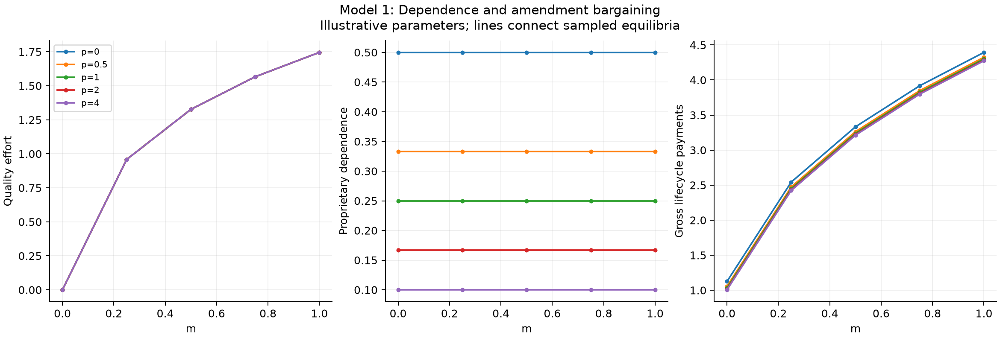
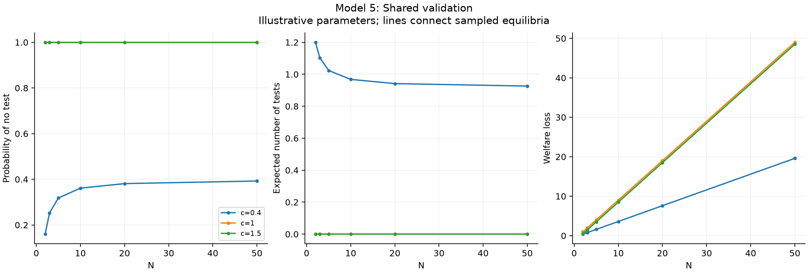
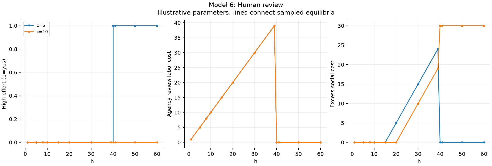
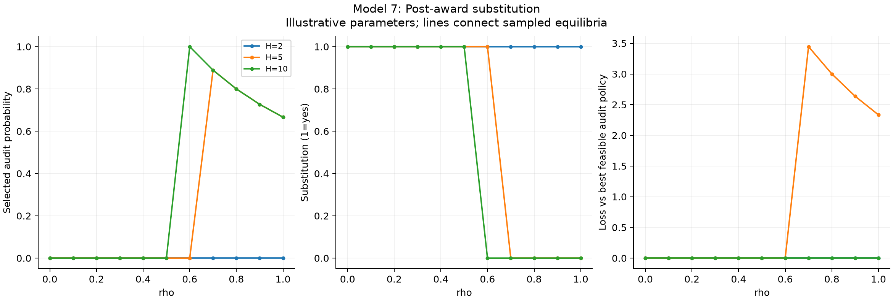

# Simulation results

Illustrative deterministic equilibria, not empirical estimates.

Full resolved parameters and source hashes are in `manifest.json`.

## Model 1: Dependence and amendment bargaining

25 parameter combinations. [Data](model_1.csv).

- Quality effort: 0 to 1.746.
- Proprietary dependence: 0.1 to 0.5.
- Gross lifecycle payments: 1.005 to 4.394.
- 5 scenarios require negative initial bids; these use unrestricted-bid theory, not a bid floor.

## Model 2: Paid remediation

33 parameter combinations. [Data](model_2.csv).

- Prevention effort: 0 to 1.327.
- Defect probability: 0.2653 to 1.
- Excess social cost: 0.2646 to 6.731.

## Model 3: Metered workflows

27 parameter combinations. [Data](model_3.csv).

- Workflow intensity: 0 to 7.265.
- Verified success probability: 0 to 0.9735.
- Welfare loss: 0.004641 to 28.11.

## Model 4: Rewarded flags

33 parameter combinations. [Data](model_4.csv).

- Flagging threshold: 0 to 1.
- False flags per case: 0 to 0.5.
- Welfare loss: 0.007143 to 16.46.

## Model 5: Shared validation

18 parameter combinations. [Data](model_5.csv).

- Probability of no test: 0.16 to 1.
- Expected number of tests: 0 to 1.2.
- Welfare loss: 0.4 to 49.

## Model 6: Human review

24 parameter combinations. [Data](model_6.csv).

- High effort (1=yes): 0 to 1.
- Agency review labor cost: 0 to 39.
- Excess social cost: 0 to 30.

## Model 7: Post-award substitution

33 parameter combinations. [Data](model_7.csv).

- Selected audit probability: 0 to 1.
- Substitution (1=yes): 0 to 1.
- Loss vs best feasible audit policy: 0 to 3.444.

