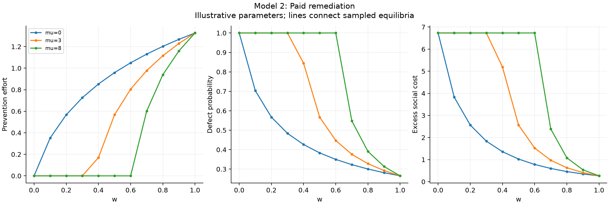
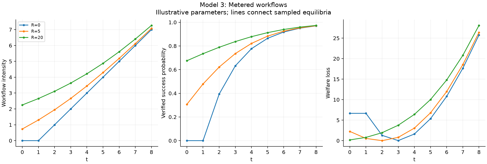
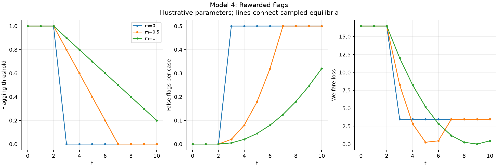
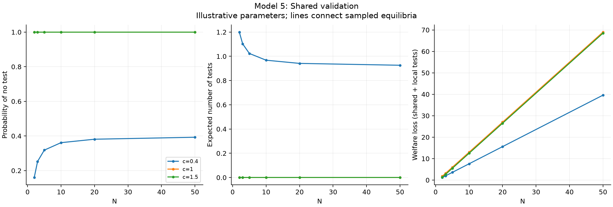
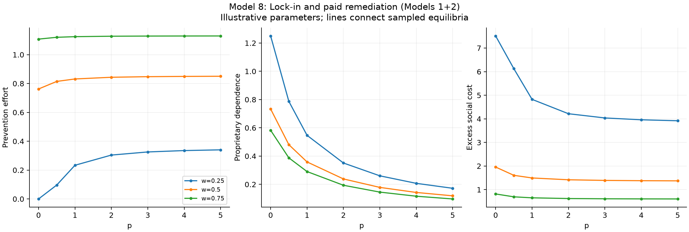
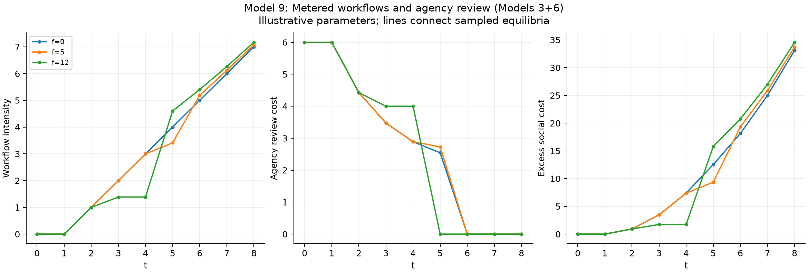

# Simulation results

Illustrative deterministic equilibria, not empirical estimates.

Full resolved parameters and source hashes are in `manifest.json`.

## Model 1: Dependence and amendment bargaining

25 parameter combinations. [Data](model_1.csv).

- Quality effort: 0 to 1.746.
- Proprietary dependence: 0.1 to 0.5.
- Gross lifecycle payments: 1.005 to 4.394.
- 5 scenarios require negative initial bids; these use unrestricted-bid theory, not a bid floor.

## Model 2: Paid remediation

33 parameter combinations. [Data](model_2.csv).

- Prevention effort: 0 to 1.327.
- Defect probability: 0.2653 to 1.
- Excess social cost: 0.2646 to 6.731.

## Model 3: Metered workflows

27 parameter combinations. [Data](model_3.csv).

- Workflow intensity: 0 to 7.265.
- Verified success probability: 0 to 0.9735.
- Welfare loss: 0.004641 to 28.11.

## Model 4: Rewarded flags

33 parameter combinations. [Data](model_4.csv).

- Flagging threshold: 0 to 1.
- False flags per case: 0 to 0.5.
- Welfare loss: 0.007143 to 16.46.

## Model 5: Shared validation

18 parameter combinations. [Data](model_5.csv).

- Probability of no test: 0.16 to 1.
- Expected number of tests: 0 to 1.2.
- Welfare loss (shared + local tests): 1.2 to 69.

## Model 6: Human review

24 parameter combinations. [Data](model_6.csv).

- High effort (1=yes): 0 to 1.
- Agency review labor cost: 0 to 39.
- Excess social cost: 0 to 30.

## Model 7: Post-award substitution

33 parameter combinations. [Data](model_7.csv).

- Selected audit probability: 0 to 1.
- Substitution (1=yes): 0 to 1.
- Loss vs best feasible audit policy: 0 to 3.444.

## Model 8: Lock-in and paid remediation (Models 1+2)

21 parameter combinations. [Data](model_8.csv).

- Prevention effort: 0 to 1.13.
- Proprietary dependence: 0.0968 to 1.25.
- Excess social cost: 0.6052 to 7.512.

## Model 9: Metered workflows and agency review (Models 3+6)

27 parameter combinations. [Data](model_9.csv).

- Workflow intensity: 0 to 7.167.
- Agency review cost: 0 to 6.
- Excess social cost: 0 to 34.57.

## Optimal contract design

The agency commits to instruments before the continuation game. Values are the stated objective net of quadratic governance costs; full outcomes are in [design.json](design.json). Where an interval of instrument values is optimal (discrete regimes), one optimum is reported.

| Problem | Objective | Optimal instruments | Optimal value | Value at default terms |
| --- | --- | --- | --- | --- |
| Model 1, agency chooses monitoring and portability (omega=0) | agency_value | m=0.86, p=0.429 | 11.7 | 11.23 |
| Model 1, agency chooses monitoring and portability (omega=1) | agency_value | m=1, p=0.429 | 10.79 | 9.903 |
| Model 1, agency chooses monitoring and portability (omega=3) | agency_value | m=1, p=0.429 | 9.042 | 7.25 |
| Model 1, social optimum over monitoring and portability | social_welfare_if_penalty_transfer | m=1, p=0.429 | 12.53 | 11.23 |
| Model 2, warranty enforcement with enforcement cost | social_cost | w=0.769 | 5.173 | 6.332 |
| Model 2, warranty enforcement and repair-price cap | social_cost | w=0.57, mu=0 | 4.766 | 6.332 |
| Model 3, usage price only | social_welfare | t=2.89 | 6.66 | 6.642 |
| Model 3, outcome bonus only | social_welfare | R=14.9 | 6.66 | 0 |
| Model 3, usage price and outcome bonus | social_welfare | t=2.5, R=2 | 6.66 | 6.642 |
| Model 4, per-flag reward | social_welfare | t=5.43 | 16.46 | 16.2 |
| Model 4, per-flag reward and costly false-flag enforcement | social_welfare | t=2.4, m=0.0576 | 16.45 | 15.7 |
| Model 6, penalty on uncorrected errors | social_cost | f=64.9 | 15 | 20 |
| Model 8, warranty enforcement and portability (costly) | social_cost | w=0.681, p=0.626 | 6.083 | 6.364 |
| Model 9, usage price and uncorrected-error penalty | social_cost | t=0, f=0 | 6 | 9.472 |
| Model 9, add verified-correctness bonus | social_cost | t=0, R=0, f=0 | 6 | 9.472 |
